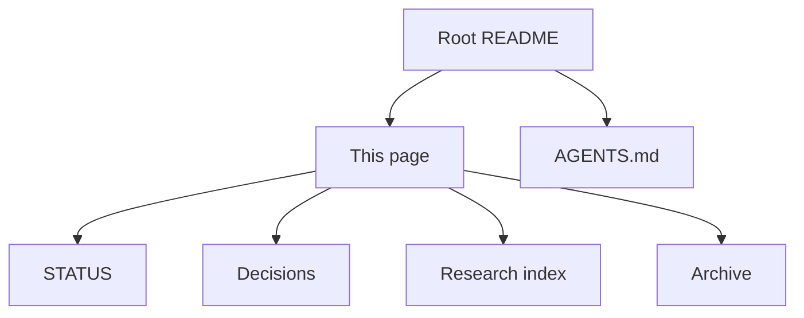

# Documentation

Protocol v0.1. This page is the map. It does not change what the software does.

## Where to start

| Reader | Open |
|---|---|
| New contributor | [Root README](../README.md), then [status](STATUS.md) |
| Research reader | [Research index](research/README.md) |
| Cursor coding agent | [AGENTS.md](../AGENTS.md). Do not load `docs/archive/` unless the task is provenance, a citation, or a contradiction |
| Dataset and rights work | [Decision 0001](decisions/0001-foundation-choices.md), [decision 0003](decisions/0003-p01-ingestion.md), [data governance](research/01_DATA_GOVERNANCE.md) |
| P0 listening experiment | [P0 listening protocol](research/02_P0_LISTENING_PROTOCOL.md) |
| Encoder development | [Decision 0002](decisions/0002-audition-normalization.md), [encoder and model](research/03_ENCODER_AND_MODEL.md) |
| Training and evaluation | [Training and evaluation](research/04_TRAINING_AND_EVALUATION.md) |
| Historical research | [Archive](archive/README.md) |

## Authority

1. Source, tests, `configs/`, and `uv.lock` establish what the software does.
2. [`docs/decisions/`](decisions/) establish accepted engineering choices. [Decision 0004](decisions/0004-votelle-naming.md) records the live names: Votelle, `votelle_music`, `votelle-music`, `VotelleError`.
3. [`docs/research/`](research/README.md) establishes scientific requirements the tests do not retire.
4. [`docs/PROJECT_DIRECTION.md`](PROJECT_DIRECTION.md) states long-term intent. It does not expand protocol v0.1.
5. [`docs/STATUS.md`](STATUS.md) records implementation and research status.
6. [`docs/archive/`](archive/README.md) is earlier rationale and citations. It does not override a later decision or the code.

The implemented commands are `votelle-music validate`, `split`, `ingest`, and `prepare`. Training, ranking, and a core CLAP adapter are not commands in this tree.
